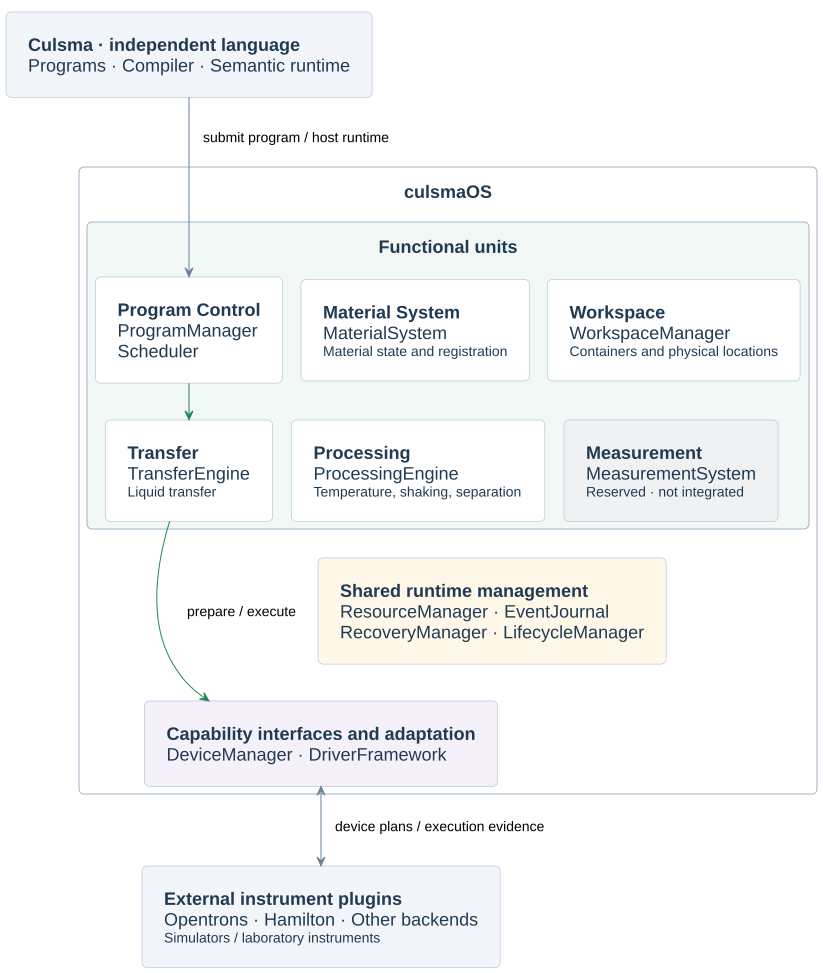

# culsmaOS

**An operating-system framework for executing laboratory protocols.**

[Culsma](https://culsma.dev/) defines the experiment. culsmaOS schedules its
execution on instruments through external plugins, manages laboratory
resources, and keeps material state tied to device evidence. Uncertain execution
outcomes remain explicit and block further execution of the affected run.

[Install](#installation) · [Run an example](#quick-start) · [Example protocols](#example-protocols) · [Architecture](#architecture)

**0.1.1 experimental preview** · Python 3.11–3.12 · [Apache-2.0](LICENSE)

## Architecture

[](diagrams/abstract-machine-os-functional-units-v1.svg)

Green arrows highlight the Transfer path. Shared runtime management serves all
functional units. Measurement remains reserved.

[Full functional architecture](diagrams/abstract-machine-os-functional-units-v1.svg) · [Module diagrams](docs/module/README.md)

## Design principles

- **Semantics before execution.** The Culsma language owns experiment semantics,
  type checking and material rules. The OS coordinates device execution against
  those semantics and the program's requirements.
- **State backed by evidence.** Proposed material changes and device execution
  evidence are recorded separately. Completing a device action does not establish
  a measured experimental result.
- **Uncertainty is explicit.** An unknown outcome is not treated as success,
  failure or proof that nothing happened. Unresolved recorded actions are not
  automatically redispatched, and their proposed material changes remain uncommitted.
- **System-level enforcement.** The OS enforces resource exclusion, reservations
  and dispatch control within the managed station, independently of whether the
  caller is a person, a script or an AI agent.

## What it does

- **Run complete protocols:** execute once or submit programs to a resident station queue.
- **Manage resources across programs:** track plate positions, tips and resource reservations.
- **Inspect execution:** review results, device evidence and unresolved outcomes.

The current preview supports one station with one worker and fixed configuration.
Its main execution path is validated with the official Opentrons simulator;
physical instrument operation is not yet accepted. culsmaOS runs as a Python
application on the host computer.

## Installation

Use **Python 3.11 or 3.12**. The commands below use a macOS/Linux shell;
installed-package validation has been performed on macOS. The resident service
requires Unix-domain sockets.

Install this preview from the [release artifacts](https://github.com/culsma/culsmaOS/releases/tag/0.1.1).
The installation below selects the compatible language and simulator wheels
automatically. PyPI publication is deferred.

```sh
git clone https://github.com/culsma/culsmaOS.git
cd culsmaOS
git checkout 0.1.1
python3.11 -m venv .venv
. .venv/bin/activate
```

Install the OS with its simulator profile:

```sh
python -m pip install --constraint requirements/preview-constraints.txt \
  --requirement requirements/preview-downloads.txt \
  'culsma-os[simulator] @ https://github.com/culsma/culsmaOS/releases/download/0.1.1/culsma_os-0.1.1-py3-none-any.whl'
python -m pip check
culsma-os --help
```

Use `python3.12` in place of `python3.11` if needed. Run the examples below from
this checkout with the virtual environment activated. No physical robot is
required.

## Quick start

The bundled [transfer example](examples/transfer/transfer.culs) starts with 200 µL
of buffer and moves 50 µL twice into a second tube:

```text
let source = tube(capacity = 2000uL, load = [
    content(kind = ContentKind.FORMULATION, type = ContentType.BUFFER, code = "BUFFER"):200uL
]);
let destination = tube(capacity = 2000uL);
let alias = source;
destination << [alias:50uL];
destination << [source:0.05mL];
```

Run it with the supplied [OT-2 deck configuration](examples/transfer/deck.json):

```sh
export CULSMA_OS_STATION_ROOT="$PWD/run-artifacts/stations"
culsma-os run examples/transfer/transfer.culs \
  --station-id quickstart \
  --host-db run-artifacts/quickstart/os.sqlite3 \
  --driver-config examples/transfer/deck.json \
  --artifacts-dir run-artifacts/quickstart
```

In simulation, messages such as `robot_settings.json not found. Loading defaults`
and `Deck calibration not found` are expected when local settings are absent;
they do not by themselves indicate a failed run.

Expected saved result (the terminal summary is not a per-container inventory):

| Item | Simulated outcome |
| --- | --- |
| OS run status | `completed` |
| Source tube | 100 µL remaining |
| Destination tube | 100 µL received |

The terminal's `materials` section shows 100 µL used from the source; it does
not list the destination's final volume. In `run-artifacts/quickstart/`,
`run.json` records both tubes under `state.artifacts.material_state.containers`.
`result.json` contains the OS outcome, and `os.sqlite3` stores the run and checkpoints.

For another independent simulation, choose a new station ID and output directory.
Reusing a station preserves recorded tip usage and other station resources.

## Run a resident station

`run` executes once and exits. Use `serve` to keep a station running and accept
program submissions.

```sh
# Terminal 1: keep the host running.
culsma-os serve --station-id transfer-service \
  --socket /tmp/culsma-os.sock \
  --host-db run-artifacts/service/os.sqlite3 \
  --driver-config examples/transfer/deck.json \
  --artifacts-dir run-artifacts/service
```

In a second terminal, activate the same virtual environment and run from the
same checkout. Check readiness before submitting:

```sh
culsma-os host-status --socket /tmp/culsma-os.sock
```

Wait until the response contains `"status": "ready"`. Startup can take a few
seconds; repeat this check if initialization is still in progress. An early
submission returns `HOST_NOT_READY` and must be submitted again after readiness.

```sh
culsma-os submit examples/transfer/transfer.culs --socket /tmp/culsma-os.sock
culsma-os runs --socket /tmp/culsma-os.sock
culsma-os device-status --socket /tmp/culsma-os.sock
```

Submission returns a run ID; use `runs` to check completion before stopping the
host:

```sh
culsma-os host-stop --socket /tmp/culsma-os.sock
```

`device-status` shows recorded device state. `run` does not automatically
connect to a resident host. See `culsma-os --help` for status, pause, resume and
cancel commands.

## Example protocols

| Example | What it exercises |
| --- | --- |
| [Liquid transfer](examples/transfer/transfer.culs) | Two tubes, typed material and unit conversion |
| [PCR program](examples/pcr-benchmark/protocol.culs) · [Flow](examples/pcr-benchmark/flow.svg) | Liquid preparation and a complete 30-cycle thermal protocol |
| [Magnetic bead program](examples/magnetic-buffer-exchange/protocol.culs) · [Flow](examples/magnetic-buffer-exchange/flow.svg) | Initial capture and two static washes; OT-2 and Flex profiles |
| [Shared resident station](docs/development.md#resident-acceptance) | Commands for separate PCR and bead programs using the same station resources |

Run these from the same checkout and activated environment as Quick start.
Each example below uses its own station and output directory:

```sh
# PCR on the OT-2 simulator
culsma-os run examples/pcr-benchmark/protocol.culs \
  --station-id pcr-demo \
  --host-db run-artifacts/pcr/os.sqlite3 \
  --driver-config examples/pcr-benchmark/deck.json \
  --artifacts-dir run-artifacts/pcr

# Magnetic bead buffer exchange on the OT-2 simulator
culsma-os run examples/magnetic-buffer-exchange/protocol.culs \
  --station-id beads-demo \
  --host-db run-artifacts/beads/os.sqlite3 \
  --driver-config examples/magnetic-buffer-exchange/deck.json \
  --artifacts-dir run-artifacts/beads

# The same bead program with Flex plate movement
culsma-os run examples/magnetic-buffer-exchange/protocol.culs \
  --station-id beads-flex-demo \
  --host-db run-artifacts/beads-flex/os.sqlite3 \
  --driver-config examples/magnetic-buffer-exchange/deck-flex.json \
  --artifacts-dir run-artifacts/beads-flex
```

## Scope and documentation

Transfer, temperature control, shaking, magnetic separation and plate movement
are integrated for restricted device profiles. Plate centrifugation is validated
through third-party protocol simulation. See the [capability map](design/instrument-capability-map.json)
for exact coverage.

The preview has no GUI, parallel execution, general manual reconciliation or
measurement/readout integration. Material quantities are modeled; device action
completion does not establish a measured biological result. Hamilton physical
execution and general cross-device compatibility remain outside the accepted
baseline.

- [Architecture and module diagrams](docs/module/README.md)
- [Functional review](docs/review/framework-functional-review.md)
- [Development and acceptance](docs/development.md) · [Test organization](tests/README.md)
- [Release notes](CHANGELOG.md) · [Compatible dependency versions](design/distribution-contract.json)

## How to cite

Cite the software version used for your work. Author and version metadata are
provided in [CITATION.cff](CITATION.cff); the archived release DOI will be added
when the record is available.

## License

culsmaOS is licensed under [Apache-2.0](LICENSE). External plugins and vendor
packages have their own licenses.
